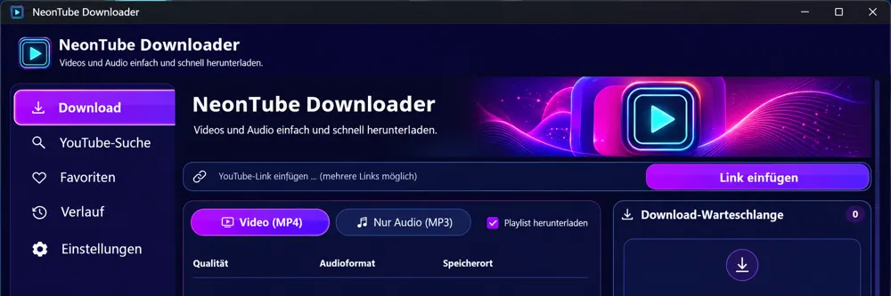

# NeonTube Downloader

**A modern YouTube video and audio downloader for Windows — with a German-language interface, portable distribution, and an easy-to-use GUI.**

YouTube Downloader for Windows · MP4 & MP3 · Playlists · Download Queue · yt-dlp GUI

### [⬇️ Download NeonTube Downloader V1.38.0 — Portable for Windows](https://github.com/M-to-S11/NeonTube-Downloader/releases/download/v1.38.0/NeonTubeDownloader_Portable_V1.38.0_Windows.zip)

[📦 All releases](https://github.com/M-to-S11/NeonTube-Downloader/releases) · [📖 Installation](#installation-and-first-launch) · [✨ Features](#features) · [🛠️ Troubleshooting](#troubleshooting)

---

## What is NeonTube Downloader?

**NeonTube Downloader** is a Windows desktop application with a modern graphical user interface for downloading video and audio through YouTube links. It supports individual videos, playlists, and multiple simultaneous downloads. Choose from **MP4, MP3, M4A, and WAV**, and manage downloads through a built-in queue.

**No Python installation required:** Download and extract the **portable Windows ZIP**, then launch `NeonTubeDownloader.exe`.

**Language note:** This documentation is in English, but the current application interface is in **German**. The steps below include the original German button names so you can find them easily.

## Interface preview

*Design preview of the download screen. The appearance may differ slightly from the published Windows version.*

## Highlights

- **Video and audio:** Download MP4 videos with quality selection up to 4K (when available), or save audio as MP3, M4A, or WAV.
- **Playlists and batch downloads:** Enter links individually, paste multiple links on separate lines, or download a playlist.
- **Download management:** View progress, speed, estimated remaining time, and pause, resume, or cancel jobs.
- **Convenience features:** Link previews, download history, favorites, saved profiles, and YouTube search using your own API key.
- **Portable Windows app:** A ZIP for Windows x64 with the executable and its supporting files in one folder. No separate Python or VLC installation is required.

> **Important:** Only download content for which you have the necessary rights or permission. The portable executable is **not digitally signed**; Windows Smart App Control may block it. This application is not affiliated with YouTube or Google.

---

## Installation and first launch

1. Open the [V1.38.0 release page](https://github.com/M-to-S11/NeonTube-Downloader/releases/tag/v1.38.0). Under **Assets**, download `NeonTubeDownloader_Portable_V1.38.0_Windows.zip`. The automatically generated **Source code** archives are for developers and **do not contain the ready-to-run portable Windows app**.
2. In Windows, right-click the downloaded ZIP file and choose **Extract All**.
3. Open the extracted `NeonTubeDownloader` folder and launch `NeonTubeDownloader.exe`. Keep the `_internal` folder next to the executable.
4. In the app's sidebar, select **Download**. Under **Speicherort → Durchsuchen** (*Save location → Browse*), choose where downloaded files should be saved.

The portable release targets **Windows x64**. You do not need to install Python or run a traditional setup wizard on the computer where you use this ZIP. Because the executable is unsigned, Windows Smart App Control may block it. Do not disable your system's security protection just to run an unfamiliar application.

## How to download a video or audio file

1. Copy the link to the YouTube video you want to download. Click **Link einfügen** (*Paste link*) or paste it directly into the URL field. You can paste several links, one per line.
2. Choose **Video (MP4)** or **Nur Audio (MP3)** (*Audio only*). For videos, select a quality offered by YouTube. In audio mode, use **Audioformat** (*Audio format*) to choose **MP3**, **M4A**, or **WAV**.
3. Enable **Playlist herunterladen** (*Download playlist*) if you want to process an entire playlist.
4. Click **Download starten** (*Start download*). The queue on the right displays available status information, progress, speed, and estimated time remaining.
5. Select an item to pause, resume, or cancel it. You can find completed files in your selected download folder or through **Verlauf** (*History*).

Only download material that you own or are authorized to save.

## Features

| Feature | Description |
| --- | --- |
| Link detection and preview | Detect copied YouTube links and ask for confirmation before inserting them. Available metadata, such as video titles and thumbnails, appears in the preview. Detecting a link does **not** automatically start a download. |
| Video, audio, and playlists | Process single videos and playlists. Download MP4 in available qualities (up to a selectable 4K option when supported) or save audio as MP3, M4A, or WAV. |
| Download queue | Run multiple downloads, pause or resume jobs, cancel or remove selected entries, and track progress, file size, speed, and estimated remaining time. |
| Automatic retries | Retry certain temporary connection failures. Existing partial downloads are reused when supported by the download source. |
| Duplicate protection | Avoid duplicate entries in the active queue. When a file in the same format has already been downloaded, NeonTube asks before downloading it again. |
| YouTube search | Search for videos using your own YouTube Data API v3 key. Browse thumbnails, titles, channel information, and additional results; add multiple search results to the queue. |
| Favorites and history | Save search results using the heart icon, revisit your favorites, and view previously completed downloads. |
| Download folders and profiles | Save preferred formats and quality settings. Optionally organize new downloads into folders by channel, playlist, or file format. |
| Download log | Review messages from the current session, copy them, or save them to a text file. |

## Set up YouTube search and favorites

1. Open the [Google Cloud Console](https://console.cloud.google.com/apis/library/youtube.googleapis.com), enable **YouTube Data API v3** for your project, and create an API key.
2. In NeonTube, open **Einstellungen → YouTube Data API v3** (*Settings*), paste your key, and click **Einstellungen speichern** (*Save settings*).
3. Open **YouTube-Suche** (*YouTube search*) in the sidebar. Use **Link übernehmen** (*Use link*) to place a search result in the URL field, or click the heart icon to save it under **Favoriten** (*Favorites*). Check several results to add them to the download queue together.

**You do not need an API key to download from a YouTube link you already have.** The app stores settings, favorites, and history in your Windows user profile at `%APPDATA%\NeonTubeDownloader`. Keep your API key private.

## Troubleshooting

| Problem | What to check |
| --- | --- |
| The app will not start or files are missing | Extract the ZIP again and start the executable from the complete `NeonTubeDownloader` folder, keeping `_internal` alongside it. |
| Windows Smart App Control blocks the executable | The portable executable is unsigned. Do not assume that bypassing Windows security is safe; use software from a source you trust. |
| YouTube search returns an API error | Verify that YouTube Data API v3 is enabled in the correct Google Cloud project and that the API key was saved in NeonTube. |
| A download fails | Open **Download-Protokoll** (*Download log*) and inspect the error message. For storage errors, check the available disk space and write permissions for the selected folder. |
| Files appear in unexpected subfolders | Check **Einstellungen → Downloads sortieren** (*Settings → Organize downloads*) to see whether sorting by channel, playlist, or format is enabled. |

## Third-party licenses

NeonTube uses third-party software, including yt-dlp, Deno, FFmpeg, and Python libraries. See [THIRD_PARTY_LICENSES.txt](THIRD_PARTY_LICENSES.txt) for a license overview and important redistribution notes.

**That overview is not a substitute for the complete required license texts, copyright notices, or source-code availability obligations.** In particular, the exact FFmpeg binaries and other components distributed in the portable Windows ZIP require their own license-compliance review.

## Technology and building from source

- **CustomTkinter** provides the GUI; **yt-dlp** handles media links; **FFmpeg** and **FFprobe** handle media processing and inspection; and **Deno** supports JavaScript execution during YouTube extraction.
- On a Windows build computer with Python installed, run `PORTABLE_ERSTELLEN.bat` to build your own portable ZIP. The output is saved in the `dist` folder. See [the portable build instructions](PORTABLE_START_HIER.txt) and [the Windows executable guide](WINDOWS_EXE_ANLEITUNG.txt).
- This repository also includes a GitHub Actions workflow named **Portable Windows-Version**. Open **Actions → Portable Windows-Version → Run workflow** to build the version configured in `build_windows.py`. A matching Git tag such as `v1.38.0` can trigger the workflow too. A release is skipped if that version has already been published.

**Current release: V1.38.0 — without the built-in video player.**
